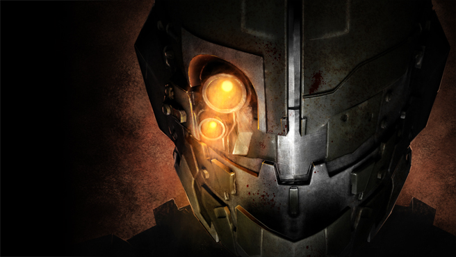

<p align="center">
  
</p>

```
================================================================================
______ _____  ___ ______   ___________  ___  _____  _____   _____
|  _  \  ___|/ _ \|  _  \ /  ___| ___ \/ _ \/  __ \|  ___| / __  \
| | | | |__ / /_\ \ | | | \ `--.| |_/ / /_\ \ /  \/| |__   `' / /'
| | | |  __||  _  | | | |  `--. \  __/|  _  | |    |  __|    / /
| |/ /| |___| | | | |/ /  /\__/ / |   | | | | \__/\| |___  ./ /___
|___/ \____/\_| |_/___/   \____/\_|   \_| |_/\____/\____/  \_____/

 _____ _____ _   _ ___________ ___________  ______  _____
/  ___|  ___| | | |  ___| ___ \  ___|  _  \ | ___ \/  __ \
\ `--.| |__ | | | | |__ | |_/ / |__ | | | | | |_/ /| /  \/
 `--. \  __|| | | |  __||    /|  __|| | | | |  __/ | |
/\__/ / |___\ \_/ / |___| |\ \| |___| |/ /  | |    | \__/\
\____/\____/ \___/\____/\_| \_\____/|___/   \_|     \____/
                                                FAQ / README / Port Guide
================================================================================
  Game ......... Dead Space 2 (PC, Steam / Origin retail)
  DLC .......... Dead Space 2: Severed 
  Platform ..... Windows (PC)
  Version ...... 0.4.0 (pre-alpha, test builds only)
  Author ....... tubzbuster
  Updated ...... 2026-10-17
================================================================================
Use Ctrl+F with the codes below to jump to a section.
```

```text
================================================================================
                           TABLE OF CONTENTS
================================================================================
  [SV00] ........ Version History
  [SV01] ........ Introduction (READ THIS FIRST)
  [SV02] ........ What Works / What Doesn't
  [SV03] ........ What You Need
  [SV04] ........ Trying the Test Build
  [SV05] ........ Removing It
  [SV06] ........ How It Works
  [SV07] ........ Troubleshooting
  [SV08] ........ Research Tools
  [SV09] ........ For Developers
  [SV10] ........ Disclaimer & Legal
  [SV11] ........ Credits
================================================================================
```

```text
================================================================================
[SV00]                         VERSION HISTORY
================================================================================
```

**v0.4.0 (2026-10-17)**: About 75% of chapter 2 plays (11 of its 15
checkpoints). From the crash landing through the decompression room, the
gift shop, the morgue, the hospital lobby, the upper corridors, the surgery
ward, the recreation rooms and the observation deck, the psych ward scene
with Lexine, the Oracle and the captain, up to the saferoom by the chase
hall. Still to play: the security room, the chase hall and the landing bay
finale. Fixes in this round:
- the crash entering the decompression room (looping sounds that start
  mid-sample are split for the PC's decoder)
- the gift shop's strobing lights calmed (comfort change)
- the converter writes its window text to `tools\test\make_severed_test.log`

Known problems: black surfaces and stretched black shapes in the hospital
(lightmap-shader materials drawn black; found in the zero-oxygen hallway,
fix in progress), flat beige windows in that hallway, sideways reflections
in the clinic overlook room, Gabe floating above the gunship after the
docking transition (fix pending a test), Gabe does not drop to the floor
after the hanging fight (fix pending a test), the Pulse Rifle sits oddly in
Gabe's hands (future release). See `docs/PROGRESS.md`.

**v0.3.0 (2026-10-17)**: All of chapter 1 plays, and chapter 2 starts.
From the mining camp through the elevator fall and the hanging fight, the
docking station and the gunship fight, then the crash landing at the
hospital with its scene, dialogue and the "Chapter 2" title, the Tormentor
fight and the zero-oxygen hallway. Fixes in this round:
- Gabe has his upgraded Pulse Rifle (the probe buys the DLC's upgrade
  nodes at level start)
- the quarry door that drew solid black (lightmap meshes get the PC's
  20-byte texture coordinates)
- the suit packs are out of Severed's stores (choosing one crashed)
- the crash on reaching the docking station (gunship meshes: an unswapped
  vertex buffer index)
- the black screen after the gunship scene (an animation blend value left
  unswapped kept chapter 2's opening from starting)
- the gunship hull is now built from the PC game's own mesh (its textures
  were smeared)

Known problems: a black shape and flat windows in the zero-oxygen hallway,
Gabe does not drop to the floor after the hanging fight, a thump in the
opening scene, the Pulse Rifle sits oddly in Gabe's hands (future release).
See `docs/PROGRESS.md`.

**v0.2.0 (2026-10-16)**: Chapter 1 plays from the opening through the
drill tunnel, saferoom, grinder, the quarry and its door encounter, the
cargo lift, and on into the mining camp's quarantine lockdown. Fixes in this
round:
- Necromorphs move and chase (navmesh checksums recomputed)
- the quarry no longer crashes or goes black: Severed's colour-grading LUTs
  are now converted to the PC's 3D form
- the quarry's scripted chain (Price, the override terminal, the door
  encounter) runs as on console
- video audio, animation banks and rig files converted more accurately
- saving and loading work

Known problems: Gabe's upgraded Pulse Rifle is missing (makes the fights
hard), one quarry door draws solid black, Twitchers can stunlock Gabe,
stomping during the tentacle grab puts Gabe in the ceiling, saves show as
"Chapter 1". See `docs/PROGRESS.md`.

**v0.1.0 (2026-10-16)**: First playable test. Severed is in the episode
select (main menu > single player). The intro terminal cutscene plays with
subtitles. You load into the drill tunnel as Gabe Weller in his security
suit, with working level geometry, lighting, collision and HUD. Fixes in
this round:
- level collision (Havok `hkpStorageExtendedMeshShape`) is converted from the
  game's own Havok class descriptions
- level meshes: Xbox 360 triangle strips are rebuilt for Direct3D 9 (no
  more spikes and stretched walls)
- audio streams go where the PC looks for them (untested)

**v0.0.x (2026-10)**: Research phase. File format scans of both platforms,
then converters for every asset type Severed uses (see [SV06]). The first
in-game tests started from chapter 1. Later builds started from the episode
select.

```text
================================================================================
[SV01]                  INTRODUCTION (READ THIS FIRST)
================================================================================
```

*Dead Space 2: Severed* is a two-chapter story DLC starring Gabe Weller. It
was only ever released for Xbox 360 and PlayStation 3. The PC version of
Dead Space 2 never got it.

DS2SeveredPC converts **your own copy** of the Xbox 360 Severed add-on into
files the PC game can load. It also adds Severed to the PC episode select,
so you start it the way you do on console:

```text
  Main Menu > Single Player > New Game > Episode Select
      Dead Space 2
      Dead Space 2: Severed      <-- this one
```

How it works:
- The converter writes one extra archive, `DS2DAT2.DAT`, into your Dead
  Space 2 folder.
- A small hook DLL adds the menu entry while the game runs.
- `deadspace2.exe` and the game's own files are never modified.
- The copy protection is left alone.

> **This is pre-alpha.** You can load in and walk around. It is not yet a
> playable DLC (see [SV02]). Every test run helps, so please send your log
> (see [SV07]).

```text
================================================================================
[SV02]                    WHAT WORKS / WHAT DOESN'T
================================================================================
```

| Area | Status |
|---|---|
| Severed in the episode select | Works (via the probe DLL) |
| Intro terminal cutscene, RIG call scene, hand-over | Works, with subtitles (a thump in the opening scene) |
| Level geometry, textures, lighting, collision | Works in the areas reached (some surfaces in the hospital draw black: being fixed) |
| Playing as Gabe (security suit), HUD, inventory | Works (the Pulse Rifle sits oddly in his hands: future release) |
| Dialogue, audio logs, videos, music, ambience | Works |
| Necromorph AI, Tormentor boss | Works |
| Chapter 1: drill tunnel to the docking station | Works (Gabe does not drop to the floor after the hanging fight: fix pending) |
| Gunship fight, boarding | Works (on one replay Gabe floated above the ship after the transition: fix pending) |
| Chapter 2: crash landing to the psych ward saferoom (about 75%) | Works (black surfaces, beige hallway windows, sideways reflections in one room) |
| Stores, benches, save stations | Work (saves show as "Chapter 1"; suit packs removed from the stores) |
| Gabe's starting weapons | Given, with the Pulse Rifle upgrades |
| Performance near some lights | Drops; not investigated yet |
| Security room, chase hall, landing bay finale, ending | Not reached yet |
| One-click installer | Not yet (the test script does the job for now) |

```text
================================================================================
[SV03]                          WHAT YOU NEED
================================================================================
```

- **Dead Space 2 for PC** (Steam or retail), installed and working.
- **Your own Severed add-on file** from your Xbox 360: the package file named
  `29E2FCC04BEF1D2532C48269EC42EF2E3DBFC45845`. **Nothing from the game or the
  DLC is in this repo, and none ever will be.**
- **64-bit Python 3** from python.org (with the `py` launcher).
- **ffmpeg** (`ffmpeg.exe`), used to decode the Xbox audio.
- About **10 GB** free next to the add-on file, and **3.5 GB** in the game
  folder.

```text
================================================================================
[SV04]                       TRYING THE TEST BUILD
================================================================================
```

1. Download this repository as a zip (Code > Download ZIP) and unpack it.
   Keep the folder structure: the test script needs `tools\research` next
   to it.
2. Build the Severed archive. Run this from `tools\test`:

   ```bat
   Make-SeveredTest.bat "<Severed add-on file>" "<Dead Space 2 folder>" "<ffmpeg.exe>"
   ```

   The first run unpacks and converts everything (this takes a while).
   Later runs only redo what changed.
3. Copy `tools\probe\bin\dinput8.dll` into the Dead Space 2 folder, next to
   `deadspace2.exe`. If a `dinput8.dll` from another mod is already there,
   move it somewhere safe first.
4. Start the game as normal. Go to **Single Player > New Game > Episode Select** and
   pick **Dead Space 2: Severed**.
5. If Gabe's RIG call scene doesn't hand control back, press **F8**. This
   sends the scene's own "finished" message: you get the normal camera,
   control and Gabe's starting gear. You'll hear the Windows asterisk sound.

```text
================================================================================
[SV05]                           REMOVING IT
================================================================================
```

```bat
Remove-SeveredTest.bat "<Dead Space 2 folder>"
```

Then delete `dinput8.dll` from the game folder. Your game is back to normal.
The script only deletes an archive it created itself. It checks for its
marker file, `DS2DAT2.DAT.severedtest`.

```text
================================================================================
[SV06]                           HOW IT WORKS
================================================================================
```

The game is the same engine on both platforms, so the job is mostly
conversion:
- byte order: the Xbox 360 is big-endian, the PC little-endian
- GPU formats: Xenos vs. Direct3D 9
- audio codecs: EA-XMA vs. EA-XAS

Each converter was checked against thousands of matching PC/360 asset pairs
from the base game.

| Asset type | What happens |
|---|---|
| Stream files (`.str`), tables of contents (`.toc`) | Rebuilt in the PC layout |
| Textures | Header rebuilt, data byte-swapped |
| Meshes | Vertices re-encoded (normals, tangents); triangle strips rebuilt without restarts |
| Materials, VFX, MetaModels, Graphs | Per-format byte-order rules |
| Havok physics (`.hkx`) | Learned rules, plus Havok's own class descriptions for collision |
| Level objects (SimGroups) | Converted with the PC engine's class layouts |
| Navigation meshes, animation banks | Per-format rules |
| Streamed audio (`.snu`), sound banks | EA-XMA decoded, re-encoded as EA-XAS |
| Text, Lua scripts | Copied (same on both platforms) |

Then the pieces are assembled:
- the converted files are packed into `DS2DAT2.DAT`, an archive slot the
  game already checks, so it loads them on top of its own files;
- the hook DLL adds the Severed episode by calling the game's own
  add-episode function, the same call the console makes when it finds the
  DLC.

The full research log is in [`docs/FINDINGS.md`](docs/FINDINGS.md). The plan
is in [`docs/DESIGN.md`](docs/DESIGN.md).

```text
================================================================================
[SV07]                         TROUBLESHOOTING
================================================================================
```

**The game writes a log.** With `dinput8.dll` installed, the game writes
`severed_probe.log` in the Dead Space 2 folder. Please attach it to any bug
report. It contains your Windows user name in some paths, so edit those out
if you like.

**`ModuleNotFoundError: No module named 'ds2'`**: you copied only the test
script. Download and unpack the whole repository.

**The window closes straight away**: run the `.bat` from a command prompt
with all three arguments in quotes, so you can read the message.

**Antivirus flags `dinput8.dll`**: it is unsigned and hooks file functions.
The full source is `tools/probe/probe.c`.

**Severed isn't in the episode list**: check that `dinput8.dll` is next to
`deadspace2.exe`, and that `DS2DAT2.DAT` exists in the game folder.

```text
================================================================================
[SV08]                          RESEARCH TOOLS
================================================================================
```

These were used to map the formats. You don't need them to try Severed.

- **`tools/scan/`**: text-only reports of a game folder or 360 package. It
  lists archive directories, the files inside a package, magic bytes and
  hashes. Run `Scan-DS2Files.bat`, or from PowerShell:

  ```powershell
  powershell -ExecutionPolicy Bypass -File .\tools\scan\Scan-DS2Files.ps1 -Path "D:\Games\Dead Space 2" -Label PC
  ```

  The labels are `PC` (the install folder), `Severed360` (a folder holding
  just the add-on file) and `Base360` (the extracted 360 base game). Add
  `-SkipHash` to skip hashing and `-ExtractTo <folder>` to extract packages.
  Paths are stored relative to the scanned folder, so your user name stays
  out of the reports.
- **`tools/export/`**, **`tools/samples/`**, **`tools/index/`**: export
  matched PC/360 asset pairs for training and checking the converters.
  These are EA data, so they stay on your machine and are git-ignored.
- **`tools/probe/`**: the diagnostic and hook `dinput8.dll` (see its
  README).

```text
================================================================================
[SV09]                          FOR DEVELOPERS
================================================================================
```

```text
  DS2SeveredPC/
  |-- docs/
  |   |-- FINDINGS.md ........... formats, engine notes, test results
  |   `-- DESIGN.md ............. plan
  |-- tools/
  |   |-- research/ds2/ ......... the converters (Python), one module per format
  |   |-- research/native/ ...... EA-XAS encoder + RefPack decompressor (C),
  |   |                           reusable in other projects: see its README
  |   |-- test/ ................. Make-SeveredTest / Remove-SeveredTest
  |   |-- app/ .................. the installer window (first version) and its build script
  |   |-- probe/ ................ dinput8.dll log + hook (C, built with zig)
  |   |-- scan/ export/ samples/ index/ archive/ ... research scripts
  `-- src/ ...................... C# port of the core readers (early)
```

**The house rules:**
- No EA game files in the repo, ever. This includes extracted samples,
  executables and logs.
- `deadspace2.exe` is never modified on disk, and its DRM is never touched.
- The probe only reads memory, and its logs contain addresses and values,
  not code.


```text
================================================================================
[SV10]                         DISCLAIMER & LEGAL
================================================================================
```

DS2SeveredPC is an **unofficial, fan-made project**. It isn't affiliated
with, endorsed by, sponsored by or approved by Electronic Arts, Visceral
Games, Motive Studio or Microsoft.

It contains no game code, assets or DLC content, and it doesn't circumvent
DRM or any other technical protection. It only converts files you supply
from **your own legitimate copy** of the Severed add-on, for use with **your
own legitimate copy** of Dead Space 2 for PC.

DS2SeveredPC is and will stay **free and non-commercial**. Nothing here is
sold, and the header image is used with permission on that basis.

The code is under the **zlib licence** (`LICENSE`): use it in your own
projects, with credit, and mark changed versions as changed. That covers
the code and docs only, not the header image or anything of EA's.

It is provided **"AS IS", WITHOUT WARRANTY OF ANY KIND**. You use it at your
own risk. Back up your saves.

```
================================================================================
[SV11]                              CREDITS
================================================================================
  * Visceral Games ..................... for Dead Space 2 and Severed
  * Rick (Gibbed) - Gibbed.Visceral ...... archive, stream and SimGroup
                                           formats (zlib licence)
  * vgmstream (ISC licence) ............ EA audio format reference
                                           (our XAS encoder, xasenc.dll,
                                           is built on its decoder notes)
  * Velocity ........................... Xbox 360 STFS package layout
                                           (reimplemented, no code used)
  * 4Kodda - DS1-3 Modding Toolkit ..... mesh format reference (no code used)
  * Havok .............................. for shipping class descriptions
  
```

<br>

<p align="center"><sub><sup>
Dead Space, Dead Space 2 and Dead Space 2: Severed are trademarks of Electronic Arts Inc.
Xbox 360 is a trademark of Microsoft Corporation.
All other trademarks are the property of their respective owners and are used here for identification purposes only.
DS2SeveredPC is not affiliated with, endorsed by, or sponsored by any of these companies.
</sup></sub></p>
