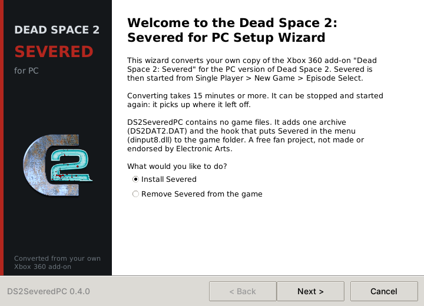
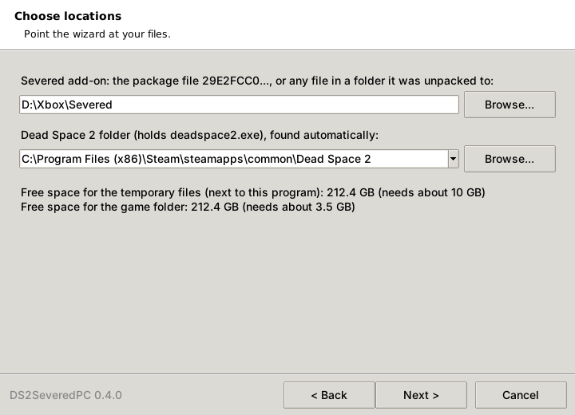
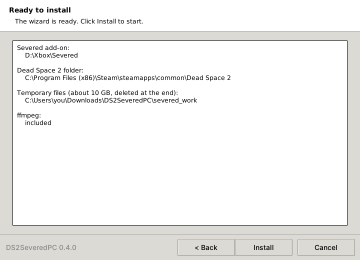
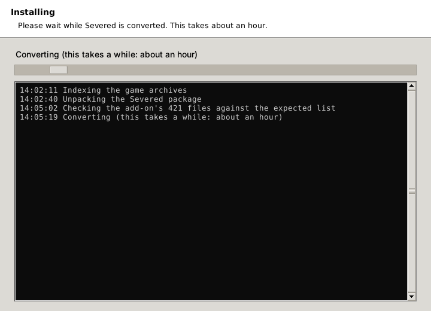
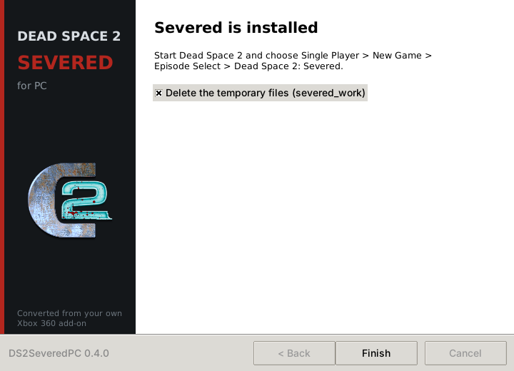
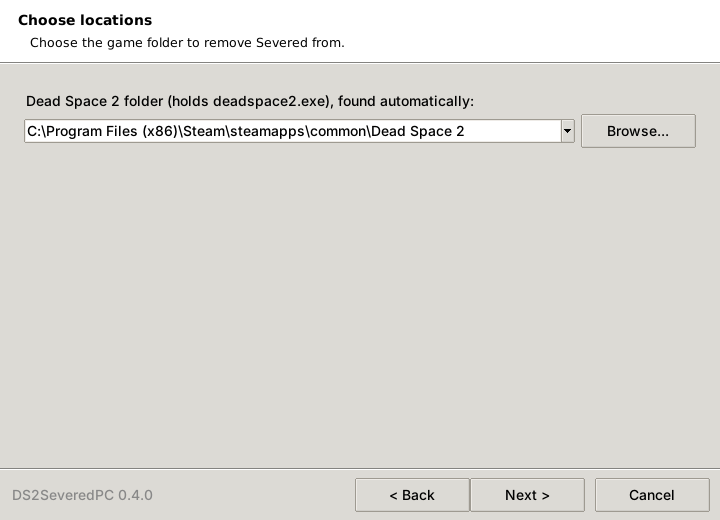
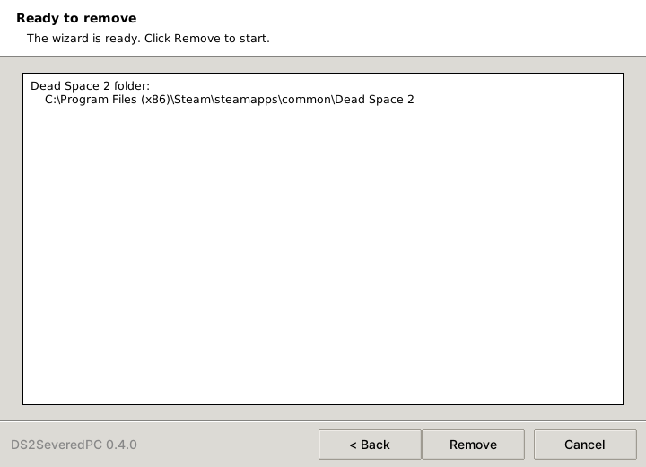
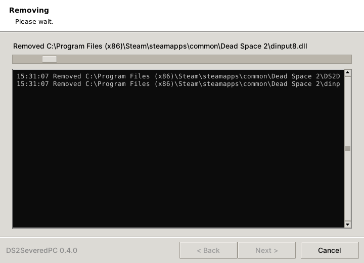
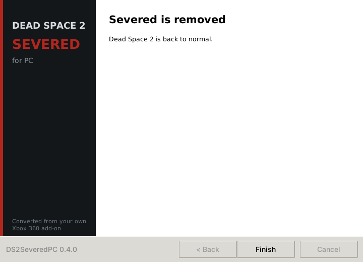

<p align="center">
  
</p>

```
================================================================================
______ _____  ___ ______   ___________  ___  _____  _____   _____
|  _  \  ___|/ _ \|  _  \ /  ___| ___ \/ _ \/  __ \|  ___| / __  \
| | | | |__ / /_\ \ | | | \ `--.| |_/ / /_\ \ /  \/| |__   `' / /'
| | | |  __||  _  | | | |  `--. \  __/|  _  | |    |  __|    / /
| |/ /| |___| | | | |/ /  /\__/ / |   | | | | \__/\| |___  ./ /___
|___/ \____/\_| |_/___/   \____/\_|   \_| |_/\____/\____/  \_____/

 _____ _____ _   _ ___________ ___________  ______  _____
/  ___|  ___| | | |  ___| ___ \  ___|  _  \ | ___ \/  __ \
\ `--.| |__ | | | | |__ | |_/ / |__ | | | | | |_/ /| /  \/
 `--. \  __|| | | |  __||    /|  __|| | | | |  __/ | |
/\__/ / |___\ \_/ / |___| |\ \| |___| |/ /  | |    | \__/\
\____/\____/ \___/\____/\_| \_\____/|___/   \_|     \____/
                                                FAQ / README / Port Guide
================================================================================
  Game ......... Dead Space 2 (PC, Steam / Origin retail)
  DLC .......... Dead Space 2: Severed 
  Platform ..... Windows (PC)
  Version ...... 0.8.5 (fully playable, start to finish)
  Author ....... tubzbuster
  Updated ...... 2026-10-18
================================================================================
Use Ctrl+F with the codes below to jump to a section.
```


I'm not going to sugarcoat it I don't know the first thing about how Xbox 360 files work. I heavily vibecoded this project with Claude which helped me decode the files and map them to the PC version. From there it was built from the ground up through testing and logging, checking how the textures look in the PC version, comparing against numerous let's plays of the console version to see what's missing and what isn't rendering, and going through countless crash dumps to make the thing I wanted

Unfortunately at this stage it isn't compatible with anything else that requires dinput8.dll which includes Marker Patch

```text
================================================================================
                                 STATUS
================================================================================
  Episode Select ............ Implemented
  Chapter 1 ................. Fully Playable
  Chapter 2 ................. Fully Playable
  Sound ..................... OK
  Dialogue .................. OK
  Cutscenes ................. OK
  Animations ................ OK
  NavMesh ................... OK
  Physics ................... OK
  Levels & Geometry ......... OK
  Textures .................. OK
================================================================================
```

```text
================================================================================
                           TABLE OF CONTENTS
================================================================================
  [SV00] ........ Version History
  [SV01] ........ Introduction 
  [SV02] ........ What Works / What Doesn't
  [SV03] ........ Installation
  [SV04] ........ Uninstallation
  [SV05] ........ How It Works
  [SV06] ........ Troubleshooting
  [SV07] ........ Research Tools
  [SV08] ........ For Developers
  [SV09] ........ Disclaimer & Legal
  [SV10] ........ Credits
================================================================================
```

```text
================================================================================
[SV00]                         VERSION HISTORY
================================================================================
```

**v0.8.5 (2026-10-18)**: first full release. Severed is fully playable
on PC from start to finish: the opening in the mines, all of chapter 1 and
chapter 2, the final fight, the last stand, the ending video, the end
screens and the credits, then back to the main menu. Changes since v0.8.2:
- the ending returns straight to the main menu, as on the console: no
  "save for New Game+" popup and no New Unlocks screen (Severed has no
  New Game+)
- the ending's end screens and its fade to black confirmed fixed
- Hardcore stays available as a choice for Severed (the console did not
  offer it; Hardcore's rules apply)
- the hook DLL is slimmed down to what the game needs: Severed in the
  episode select, Gabe's Pulse Rifle upgrades, the ending, and F7 for
  test messages. The research logging is gone (no more file-by-file log,
  less work while playing); `severed_probe.log` now holds a short status
  log and crash reports
- a ready-made F7 test file (`tools/probe/severed_send.txt`): invincibility
  and the door to the final fight

Note: **saves use the base game's save icons and chapter titles**, so
Severed saves look like Dead Space 2 saves in the load menu. They load
Severed as normal.

Still to fix (minor, none blocks the game): a pale see-through sheet under
the Oracle corpses (perhaps as on the console); the save station can lock
up if used again while it closes; frame drops near some lights in the drill
tunnel. See `docs/PROGRESS.md`.

<details><summary>Not a bug (spoiler)</summary>

Gabe's legs come back for the last few seconds after the four airlock
fuses: the console version shows the same.

</details>

**v0.8.2 (2026-10-18)**: Severed is fully playable on PC, from the
opening in the mines to the end credits. Every area of chapter 1 and
chapter 2 plays: the security room, the chase hall, the landing bay battle,
the final cutscene, the Infectors and Oracle Twitchers fight, the final
hack, the last stand with the four airlock fuses, the ending video, the end
screens and the credits. Fixes in this round:
- the black slabs, stretched black shapes and flat beige windows in the
  hospital (vertex positions left half-converted in 17 level meshes)
- the landing bay's final cutscene camera pointed at the sky (its
  animation tracks kept the wrong types)
- the crash when the Oracle Twitchers appeared (their PC meshes named a
  material that was not loaded; PC meshes now take Severed's materials)
- the final fight could not end (no dialogue, the hacking panel stayed
  locked): the Oracle corpses were thrown about where the Infectors could
  not reach them; they now hold their pose, and are built from the PC
  game's Oracle mesh
- the end screens showing all their texts at once, and the room showing
  after the ending video instead of black (timed steps in the finale's
  effects left unconverted)
- the installer app: installs the hook DLL itself, shows the conversion
  file by file without console windows, has its own icon, and the build is
  named DS2SeveredPC-Converter with a "keep all files together" note

Still to fix (minor, none blocks the game): a pale see-through sheet under
the Oracle corpses (perhaps as on the console); the save station can lock
up if used again while it closes; frame drops near some lights in the drill
tunnel; saves show the base game's chapter titles and pictures. See
`docs/PROGRESS.md`.

<details><summary>Not a bug (spoiler)</summary>

Gabe's legs come back for the last few seconds after the four airlock
fuses: the console version shows the same.

</details>

**v0.4.0 (2026-10-17)**: About 75% of chapter 2 plays (11 of its 15
checkpoints). From the crash landing through the decompression room, the
gift shop, the morgue, the hospital lobby, the upper corridors, the surgery
ward, the recreation rooms and the observation deck, the psych ward scene
with Lexine, the Oracle and the captain, up to the saferoom by the chase
hall. Still to play: the security room, the chase hall and the landing bay
finale. Fixes in this round:
- the crash entering the decompression room (looping sounds that start
  mid-sample are split for the PC's decoder)
- the gift shop's strobing lights calmed (comfort change)
- the converter writes its window text to `tools\test\make_severed_test.log`

Known problems: black surfaces and stretched black shapes in the hospital
(lightmap-shader materials drawn black; found in the zero-oxygen hallway,
fix in progress), flat beige windows in that hallway, sideways reflections
in the clinic overlook room, Gabe floating above the gunship after the
docking transition (fix pending a test), Gabe does not drop to the floor
after the hanging fight (fix pending a test), the Pulse Rifle sits oddly in
Gabe's hands (future release). See `docs/PROGRESS.md`.

**v0.3.0 (2026-10-17)**: All of chapter 1 plays, and chapter 2 starts.
From the mining camp through the elevator fall and the hanging fight, the
docking station and the gunship fight, then the crash landing at the
hospital with its scene, dialogue and the "Chapter 2" title, the Tormentor
fight and the zero-oxygen hallway. Fixes in this round:
- Gabe has his upgraded Pulse Rifle (the probe buys the DLC's upgrade
  nodes at level start)
- the quarry door that drew solid black (lightmap meshes get the PC's
  20-byte texture coordinates)
- the suit packs are out of Severed's stores (choosing one crashed)
- the crash on reaching the docking station (gunship meshes: an unswapped
  vertex buffer index)
- the black screen after the gunship scene (an animation blend value left
  unswapped kept chapter 2's opening from starting)
- the gunship hull is now built from the PC game's own mesh (its textures
  were smeared)

Known problems: a black shape and flat windows in the zero-oxygen hallway,
Gabe does not drop to the floor after the hanging fight, a thump in the
opening scene, the Pulse Rifle sits oddly in Gabe's hands (future release).
See `docs/PROGRESS.md`.

**v0.2.0 (2026-10-16)**: Chapter 1 plays from the opening through the
drill tunnel, saferoom, grinder, the quarry and its door encounter, the
cargo lift, and on into the mining camp's quarantine lockdown. Fixes in this
round:
- Necromorphs move and chase (navmesh checksums recomputed)
- the quarry no longer crashes or goes black: Severed's colour-grading LUTs
  are now converted to the PC's 3D form
- the quarry's scripted chain (Price, the override terminal, the door
  encounter) runs as on console
- video audio, animation banks and rig files converted more accurately
- saving and loading work

Known problems: Gabe's upgraded Pulse Rifle is missing (makes the fights
hard), one quarry door draws solid black, Twitchers can stunlock Gabe,
stomping during the tentacle grab puts Gabe in the ceiling, saves show as
"Chapter 1". See `docs/PROGRESS.md`.

**v0.1.0 (2026-10-16)**: First playable test. Severed is in the episode
select (main menu > single player). The intro terminal cutscene plays with
subtitles. You load into the drill tunnel as Gabe Weller in his security
suit, with working level geometry, lighting, collision and HUD. Fixes in
this round:
- level collision (Havok `hkpStorageExtendedMeshShape`) is converted from the
  game's own Havok class descriptions
- level meshes: Xbox 360 triangle strips are rebuilt for Direct3D 9 (no
  more spikes and stretched walls)
- audio streams go where the PC looks for them (untested)

**v0.0.x (2026-10)**: Research phase. File format scans of both platforms,
then converters for every asset type Severed uses (see [SV05]). The first
in-game tests started from chapter 1. Later builds started from the episode
select.

```text
================================================================================
[SV01]                  INTRODUCTION
================================================================================
```

*Dead Space 2: Severed* is a two-chapter story DLC starring Gabe Weller. It
was only ever released for Xbox 360 and PlayStation 3. The PC version of
Dead Space 2 never got it.

DS2SeveredPC converts **your own copy** of the Xbox 360 Severed add-on into
files the PC game can load. It also adds Severed to the PC episode select,
so you start it the way you do on console:

```text
  Main Menu > Single Player > New Game > Episode Select
      Dead Space 2
      Dead Space 2: Severed
```

How it works:
- The converter writes one extra archive, `DS2DAT2.DAT`, into your Dead
  Space 2 folder.
- A small hook DLL adds the menu entry while the game runs.
- `deadspace2.exe` and the game's own files are never modified.
- The copy protection is left alone.

```text
================================================================================
[SV02]                    WHAT WORKS / WHAT DOESN'T
================================================================================
```

| Area | Status |
|---|---|
| Severed in the episode select | Works (via the hook DLL) |
| Chapter 1: drill tunnel, quarry, mining camp, hanging fight, docking station, gunship | Fully playable |
| Chapter 2: crash landing, hospital, psych ward, security room, chase hall, landing bay finale | Fully playable |
| Ending: final fight, last stand, ending video, end screens, credits | Works |
| After the credits | Back to the main menu, as on the console (Severed has no New Game+) |
| Sound, dialogue, audio logs, videos, music | Works |
| Cutscenes and animations | Works |
| Necromorph AI and navigation, Tormentor boss | Works |
| Physics and collision | Works |
| Playing as Gabe (security suit), HUD, inventory, starting weapons with the Pulse Rifle upgrades | Works |
| Stores, benches, save stations | Work (suit packs removed from the stores; saves show the base game's save icons and chapter titles) |
| Levels and geometry | Works (the black slabs in the hospital are fixed) |
| Textures | Works |
| Save stations | Can lock up if used again while the terminal is closing |
| Performance | Frame drops near some lights in the drill tunnel |
| Installer app | Works (see [SV03]) |

```text
================================================================================
[SV03]                           INSTALLATION
================================================================================
```

**What you need:**
- **Dead Space 2 for PC** (Steam or retail), installed and working.
- **Your own Severed add-on** from your Xbox 360: either the package file
  named `29E2FCC04BEF1D2532C48269EC42EF2E3DBFC45845`, or a folder it has
  been fully extracted to (for example with xdvdfs). **Nothing from the game
  or the DLC is in this repo, and none ever will be.**
- **The DS2SeveredPC app.** It carries its own Python and ffmpeg, so you
  don't need to install anything else.
- **Free space:** about **10 GB** where you run the app (for temporary
  files) and **3.5 GB** in the game folder.

**Steps:**

1. Unzip the DS2SeveredPC app into a folder on a drive with at least 10 GB
   free, for example `Downloads\DS2SeveredPC`. The app keeps its temporary
   files in a `severed_work` folder next to itself while it converts, and
   deletes them when it finishes.
2. Run `DS2SeveredPC.exe`. Choose **Install Severed** and click **Next**.

   <p align="center"></p>

3. Point the app at your files:
   - **Severed add-on:** click **Browse...** and pick the package file, or
     any file inside the folder you extracted the add-on to.
   - **Dead Space 2 folder:** the folder that holds `deadspace2.exe`. Steam
     installs are usually found automatically.

   The page shows how much free space each location has. If either one
   says "not enough", free some space or move the app to another drive.

   <p align="center"></p>

4. Check the summary and click **Install**.

   <p align="center"></p>

   Converting takes 15 minutes or more. The window shows the current step
   and every file the converter works on. If it stops or you cancel it, run the app again: it
   picks up where it left off.

   <p align="center"></p>

5. When it's done, leave **Delete the temporary files** ticked and click
   **Finish**. The `severed_work` folder is removed.

   <p align="center"></p>

6. Start the game as normal. Go to **Single Player > New Game > Episode
   Select** and pick **Dead Space 2: Severed**.

The app adds three files to the game folder:
- the archive `DS2DAT2.DAT`, which holds the converted DLC;
- its marker file `DS2DAT2.DAT.severed`. Keep it: the app uses it to update
  or remove the archive later;
- the hook `dinput8.dll`, which adds Severed to the episode select. If
  another mod's `dinput8.dll` is already there, the app renames it to
  `dinput8.dll.other` and puts it back when you remove Severed.

```text
================================================================================
[SV04]                          UNINSTALLATION
================================================================================
```

1. Run `DS2SeveredPC.exe`, choose **Remove Severed from the game** and click
   **Next**.

   <p align="center"></p>

2. Check that the Dead Space 2 folder is right and click **Next**.

   <p align="center"></p>

3. Click **Remove**.

   <p align="center"></p>

   It only takes a moment.

   <p align="center"></p>

4. Click **Finish**.

   <p align="center"></p>

Your game is back to normal. The app removes the archive, its marker and the
hook `dinput8.dll`, and puts back another mod's `dinput8.dll` if it set one
aside. It only deletes files it created itself: it checks for the marker
file `DS2DAT2.DAT.severed` first (older test builds named it `.severedtest`,
which the app recognises too), and only removes a `dinput8.dll` that is its
own hook.

```text
================================================================================
[SV05]                           HOW IT WORKS
================================================================================
```

The game is the same engine on both platforms, so the job is mostly
conversion:
- byte order: the Xbox 360 is big-endian, the PC little-endian
- GPU formats: Xenos vs. Direct3D 9
- audio codecs: EA-XMA vs. EA-XAS

Each converter was checked against thousands of matching PC/360 asset pairs
from the base game.

| Asset type | What happens |
|---|---|
| Stream files (`.str`), tables of contents (`.toc`) | Rebuilt in the PC layout |
| Textures | Header rebuilt, data byte-swapped |
| Meshes | Vertices re-encoded (normals, tangents); triangle strips rebuilt without restarts |
| Materials, VFX, MetaModels, Graphs | Per-format byte-order rules |
| Havok physics (`.hkx`) | Learned rules, plus Havok's own class descriptions for collision |
| Level objects (SimGroups) | Converted with the PC engine's class layouts |
| Navigation meshes, animation banks | Per-format rules |
| Streamed audio (`.snu`), sound banks | EA-XMA decoded, re-encoded as EA-XAS |
| Text, Lua scripts | Copied (same on both platforms) |

Then the pieces are assembled:
- the converted files are packed into `DS2DAT2.DAT`, an archive slot the
  game already checks, so it loads them on top of its own files;
- the hook DLL adds the Severed episode by calling the game's own
  add-episode function, the same call the console makes when it finds the
  DLC.

The full research log is in [`docs/FINDINGS.md`](docs/FINDINGS.md). The plan
is in [`docs/DESIGN.md`](docs/DESIGN.md).

```text
================================================================================
[SV06]                         TROUBLESHOOTING
================================================================================
```

**The game writes a log.** With `dinput8.dll` installed, the game writes
`severed_probe.log` in the Dead Space 2 folder. Please attach it to any bug
report. It contains your Windows user name in some paths, so edit those out
if you like.

**Setup did not finish**: the app saves its log as `make_severed_test.log`
next to `DS2SeveredPC.exe`. Please attach it to your bug report. Running the
app again picks up where it stopped.

**"Not enough" free space**: the temporary files need about 10 GB on the
drive the app runs from. Move the app folder to a drive with more space.

**Antivirus flags `dinput8.dll`**: it is unsigned and hooks file functions.
The full source is `tools/probe/probe.c`.

**Severed isn't in the episode list**: check that `dinput8.dll` is next to
`deadspace2.exe`, and that `DS2DAT2.DAT` exists in the game folder. If
either is missing, run the app's install again.

```text
================================================================================
[SV07]                          RESEARCH TOOLS
================================================================================
```

These were used to map the formats. You don't need them to try Severed.

- **`tools/scan/`**: text-only reports of a game folder or 360 package. It
  lists archive directories, the files inside a package, magic bytes and
  hashes. Run `Scan-DS2Files.bat`, or from PowerShell:

  ```powershell
  powershell -ExecutionPolicy Bypass -File .\tools\scan\Scan-DS2Files.ps1 -Path "D:\Games\Dead Space 2" -Label PC
  ```

  The labels are `PC` (the install folder), `Severed360` (a folder holding
  just the add-on file) and `Base360` (the extracted 360 base game). Add
  `-SkipHash` to skip hashing and `-ExtractTo <folder>` to extract packages.
  Paths are stored relative to the scanned folder, so your user name stays
  out of the reports.
- **`tools/export/`**, **`tools/samples/`**, **`tools/index/`**: export
  matched PC/360 asset pairs for training and checking the converters.
  
- **`tools/probe/`**: the diagnostic and hook `dinput8.dll` (see its
  README).

```text
================================================================================
[SV08]                          FOR DEVELOPERS
================================================================================
```

```text
  DS2SeveredPC/
  |-- docs/
  |   |-- FINDINGS.md ........... formats, engine notes, test results
  |   `-- DESIGN.md ............. plan
  |-- tools/
  |   |-- research/ds2/ ......... the converters (Python), one module per format
  |   |-- research/native/ ...... EA-XAS encoder + RefPack decompressor (C),
  |   |                           reusable in other projects: see its README
  |   |-- test/ ................. Make-SeveredTest / Remove-SeveredTest
  |   |-- app/ .................. the installer window (first version) and its build script
  |   |-- probe/ ................ dinput8.dll log + hook (C, built with zig)
  |   |-- scan/ export/ samples/ index/ archive/ ... research scripts
  `-- src/ ...................... C# port of the core readers (early)
```

**The house rules:**
- No EA game files in the repo, ever. This includes extracted samples,
  executables and logs.
- `deadspace2.exe` is never modified on disk, and its DRM is never touched.
- The probe only reads memory, and its logs contain addresses and values,
  not code.


```text
================================================================================
[SV09]                         DISCLAIMER & LEGAL
================================================================================
```

DS2SeveredPC is an **unofficial, fan-made project**. It isn't affiliated
with, endorsed by, sponsored by or approved by Electronic Arts, Visceral
Games, Motive Studio or Microsoft.

It contains no game code, assets or DLC content, and it doesn't circumvent
DRM or any other technical protection. It only converts files you supply
from **your own legitimate copy** of the Severed add-on, for use with **your
own legitimate copy** of Dead Space 2 for PC.

DS2SeveredPC is and will stay **free and non-commercial**. Nothing here is
sold, and the header image is used with permission on that basis.

The code is under the **zlib licence** (`LICENSE`): use it in your own
projects, with credit, and mark changed versions as changed. That covers
the code and docs only, not the header image or anything of EA's.

It is provided **"AS IS", WITHOUT WARRANTY OF ANY KIND**. You use it at your
own risk. Back up your saves.

```
================================================================================
[SV10]                              CREDITS
================================================================================
  * Visceral Games ..................... for Dead Space 2 and Severed
  * Rick (Gibbed) - Gibbed.Visceral ...... archive, stream and SimGroup
                                           formats (zlib licence)
  * vgmstream (ISC licence) ............ EA audio format reference
                                           (our XAS encoder, xasenc.dll,
                                           is built on its decoder notes)
  * Velocity ........................... Xbox 360 STFS package layout
                                           (reimplemented, no code used)
  * 4Kodda - DS1-3 Modding Toolkit ..... mesh format reference (no code used)
  * Havok .............................. for shipping class descriptions
  * youngpotart (SteamGridDB) .......... the app icon and logo
                                           steamgriddb.com/profile/76561198110359023
  
```

<br>

<p align="center"><sub><sup>
Dead Space, Dead Space 2 and Dead Space 2: Severed are trademarks of Electronic Arts Inc.
Xbox 360 is a trademark of Microsoft Corporation.
All other trademarks are the property of their respective owners and are used here for identification purposes only.
DS2SeveredPC is not affiliated with, endorsed by, or sponsored by any of these companies.
</sup></sub></p>
